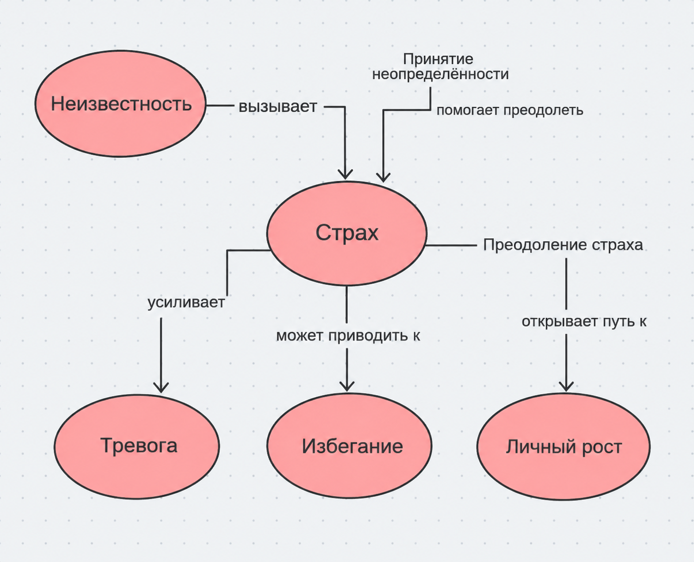

## Ответственный: Цыбиков Тумэн (М8О-102СВ-25)

## Схема связей:


## Пример запроса:
```
SELECT ?item ?itemLabel ?description WHERE {
  VALUES ?item {
    wd:Q13649246    # неизвестность 
    wd:Q44619       # страх 
    wd:Q154430      # тревога 
    wd:Q18614415    # избегание 
    wd:Q58998540    # личный рост
  }

  SERVICE wikibase:label { bd:serviceParam wikibase:language "ru,en". }

  OPTIONAL {
    ?item schema:description ?description .
    FILTER(LANG(?description) = "ru")
  }
}
```
## Ощущения от работы
Работа над темой оказалась интересной и заставила задуматься о том, почему неизвестность часто вызывает тревогу и мешает двигаться вперёд. Особенно интересно было разобраться в том, как страх перед будущим влияет на решения человека и почему иногда мы боимся не самой ситуации, а невозможности предсказать её исход. Немного сложно было объяснить эту тему простым и понятным языком для подросткового читателя, не упрощая её смысл, но в итоге удалось сделать акцент на том, что неизвестность — это не только источник страха, но и возможность для нового опыта и личностного роста.

## Сгенерированная суммаризация
В предоставленных статьях выстроена логическая цепочка: от переживаний, связанных с переходом на новый жизненный этап («Что будет после школы») через страх неудачи в образовании и профессиональной реализации («Страх не поступить/не найти работу») к поиску способов организации жизни в условиях отсутствия чёткого плана («Как жить, когда нет четкого плана»). Далее рассматриваются методы преодоления тревоги о будущем и способы справляться с неопределённостью («Тревога о будущем — что помогает»), а также значение поддержки со стороны окружающих при принятии важных решений («К кому идти за советом»). Общая суть материалов заключается в том, что страх неизвестности особенно ярко проявляется в периоды жизненных перемен, когда привычные ориентиры исчезают, а дальнейший путь кажется непредсказуемым. Неуверенность в поступлении, поиске работы и выборе жизненного направления может вызывать тревогу и затруднять принятие решений. Ключевой особенностью подхода является смещение фокуса с попыток заранее предусмотреть все возможные обстоятельства на постепенное формирование уверенности в собственных силах. Важную роль играют постановка ближайших достижимых целей, готовность адаптироваться к изменениям, использование доступных способов самопомощи и обращение за советом к людям, обладающим необходимым опытом. Таким образом, преодоление страха неизвестности заключается не в наличии готового плана на всю жизнь, а в способности принимать решения в настоящем, обращаться за поддержкой и двигаться вперёд, даже если будущее остаётся неопределённым.
